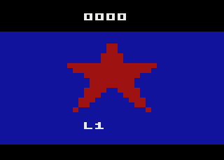
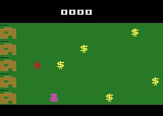
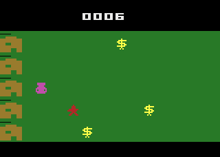

# Мальчиш-Кибальчиш — игра для Atari 2600

Горизонтальный шутер для Atari 2600 (NTSC, картридж 4K) по мотивам сказки Аркадия Гайдара.
Красная звезда (Мальчиш-Кибальчиш) защищает дома на левом краю поля. Справа наступают
доллары-буржуины. Возле домов шныряет Мальчиш-Плохиш (банка варенья): если он дойдёт до дома
и досидит до конца, дом взорвётся. Чтобы его подстрелить, нужно развернуться.

   

## Как запустить в Stella
1. Скачай `kibalchish.bin` из раздела Releases.
2. Запусти Stella. В списке ROM (launcher) зайди в папку с файлом, выбери `kibalchish.bin` и нажми Enter.
   Можно и просто перетащить файл в окно Stella или запустить `stella kibalchish.bin`.
3. Тип картриджа (4K) и формат (NTSC) Stella определяет сама, ничего настраивать не нужно.
4. Esc возвращает в список ROM, Tab открывает меню Stella.

Файл подходит и для других эмуляторов 2600 (обычный 4K-образ без банков), а также для Harmony/UnoCart на реальной приставке.

## Управление
| Действие | Джойстик | Клавиатура в Stella |
|---|---|---|
| Вверх / вниз по полосам | вверх / вниз (удержание = повтор) | стрелки ↑ ↓ |
| Шаг влево / вправо | влево / вправо | стрелки ← → |
| Развернуться | влево — смотрит налево, вправо — направо | ← / → |
| Выстрел | кнопка (один выстрел на нажатие) | пробел |
| Старт с титула / после конца игры | кнопка | пробел |

Переключатели приставки:
| Переключатель | Что делает | Клавиша в Stella |
|---|---|---|
| Game Reset | новая игра в любой момент | F2 |
| Game Select | на титуле: стартовый уровень 1–4 (надпись L1…L4); во время игры: выход на титул | F1 |
| Color / B&W | переключение во время игры ставит паузу (картинка серая, звук выключен); повторное переключение снимает паузу. Работает и как кнопка Pause на 7800 | F3 / F4 |
| Левая сложность A | доллары быстрее | F5 (A) / F6 (B) |
| Правая сложность A | Плохиш взрывает дом быстрее | F7 (A) / F8 (B) |

## Правила
- 5 полос, в каждой по дому. Доллар, дошедший до дома, разрушает его.
- Плохиш появляется у полосы с живым домом, подкрадывается и начинает взрывать (тревожный писк). Подстрели его, повернувшись налево.
- Очки: доллар +1, Плохиш +5. Счёт 4 цифры (до 9999). Рекорд показывается на титуле.
- Каждые 8 сбитых долларов уровень растёт (до 9): доллары быстрее, появляются чаще, Плохиш взрывает быстрее.
- Когда разрушены все дома, игра окончена. Через 2 секунды кнопка начинает новую игру.

## Технические характеристики
- Atari 2600, процессор 6507, 128 байт ОЗУ (занято 107 + до 6 байт стека), ПЗУ 4096 байт, без банков, векторы RESET/IRQ = $F000.
- NTSC: каждый кадр ровно 262 строки = 3 VSYNC + 37 VBLANK + 192 видимых + 30 overscan.
- Только официальные (легальные) коды 6502, старт через CLEAN_START, HMOVE строго сразу после WSYNC.
- Ассемблер: DASM 2.20, `vcs.h` / `macro.h` из поставки DASM. Код без комментариев.

## Сборка
```
./tools/build.sh
```
Скрипт собирает `kibalchish.asm` из `tools/template.asm` и графики (`tools/gfx.py`) и вызывает `dasm`.

## Проверка
- `tools/test_game.py` — сценарии на эмуляторе 6502 с моделью TIA/RIOT (py65): все направления джойстика, выстрел в обе стороны, все переключатели, пауза, конец игры и перезапуск, очки, уровни, звук, 18 000 кадров случайного ввода. Результат: `TEST_RESULTS.txt`.
- `tools/stella_run.py` — тот же сценарий в настоящем Stella 7.0 (отладчик, скриптовый ввод, контроль числа строк каждого кадра, снимки). Результат: `STELLA_RESULTS.txt`, снимки в `screenshots/`.

## Ограничения
- Счёт 4 цифры, без 6-значного 48-пиксельного табло.
- Если звезда и Плохиш в одной полосе, они мерцают через кадр (на 2600 так делают, когда спрайтов не хватает).
- Слева в начале каждой полосы видна короткая чёрная «гребёнка» от HMOVE. Это обычный эффект 2600.
- Только NTSC (60 Гц). На PAL-приставке цвета будут другими, а часть PAL-телевизоров может не удержать кадр.
- На реальном железе (Harmony/UnoCart) не проверялось, только в Stella и в собственном эмуляторе.
