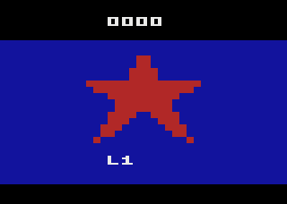
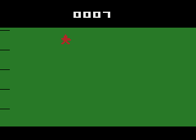

# Мальчиш-Кибальчиш — игра для Atari 2600

Горизонтальный шутер для Atari 2600 (NTSC, картридж 4K) по мотивам сказки Аркадия Гайдара.
Красная звезда (Мальчиш-Кибальчиш) защищает дома на левом краю поля. Справа наступают
доллары-буржуины. Возле домов шныряет Мальчиш-Плохиш (банка варенья): если он дойдёт до дома
и досидит до конца, дом взорвётся. Чтобы его подстрелить, нужно развернуться.

   

## Какой файл выбрать
Все версии собраны из одного исходника, отличаются только флагами сборки. Каждая есть в двух копиях: `.bin` и `.a26` (содержимое одинаковое, расширение — кому как удобнее).

| Файл | Приставка / эмулятор | Телевизор | Строк в кадре | Пауза на Color/B&W |
|---|---|---|---|---|
| `kibalchish_NTSC` | NTSC (США, Япония), любой эмулятор по умолчанию. **Если сомневаешься — бери этот** | 60 Гц | 262 | есть |
| `kibalchish_PAL` | PAL-приставка (Европа, Россия, Австралия) | PAL 50 Гц | 312 | есть |
| `kibalchish_PAL60` | PAL-приставка, но телевизор или ТВ-тюнер держит 60 Гц; эмулятор с PAL-палитрой на 60 Гц | PAL 60 Гц | 262 | есть |
| `kibalchish_SECAM` | SECAM-приставка (Франция, СССР-клоны) | SECAM 50 Гц | 312 | есть |
| `kibalchish_*_nopause` | то же самое, но переключатель Color/B&W игнорируется. Для Atari 7800, SECAM-приставок без этого переключателя, эмуляторов, где он мешает | как у основной версии | как у основной | нет |

- В PAL и SECAM игра идёт с той же скоростью, что и в NTSC: доллары, звезда, выстрел, Плохиш, таймеры пересчитаны под 50 кадров в секунду.
- В PAL и SECAM картинка 192 строки по центру кадра из 228 видимых строк, сверху и снизу чёрные поля.
- Цвета подобраны под палитру каждой системы. В SECAM всего 8 цветов: звезда красная, доллары жёлтые, банка Плохиша сиреневая, дома голубые, поле зелёное. Пауза в SECAM делает фон чёрным (серых цветов в SECAM нет).

### Stella и формат
Stella берёт формат из имени файла (`_NTSC`, `_PAL`, `_PAL60`, `_SECAM`), поэтому **не переименовывай файлы**, тогда ничего настраивать не нужно.
Если файл переименован, Stella по содержимому сама узнаёт NTSC и PAL, а PAL60 примет за NTSC, SECAM — за PAL. Тогда выбери формат вручную: Tab → Game Properties → TV format → PAL60 или SECAM (или жми Ctrl+F во время игры, пока не появится нужный формат).

## Как запустить в Stella
1. Скачай нужный файл из раздела Releases (см. таблицу выше), например `kibalchish_NTSC.bin`.
2. Запусти Stella. В списке ROM (launcher) зайди в папку с файлом, выбери файл и нажми Enter.
   Можно и просто перетащить файл в окно Stella или запустить `stella kibalchish_NTSC.bin`.
3. Тип картриджа (4K) и формат Stella определяет сама (формат — по имени файла).
4. Esc возвращает в список ROM, Tab открывает меню Stella.

Файл подходит и для других эмуляторов 2600 (обычный 4K-образ без банков), а также для Harmony/UnoCart на реальной приставке.

## Управление
| Действие | Джойстик | Клавиатура в Stella |
|---|---|---|
| Вверх / вниз по полосам | вверх / вниз (удержание = повтор) | стрелки ↑ ↓ |
| Шаг влево / вправо | влево / вправо | стрелки ← → |
| Развернуться | влево — смотрит налево, вправо — направо | ← / → |
| Выстрел | кнопка (один выстрел на нажатие) | пробел |
| Старт с титула / после конца игры | кнопка | пробел |

Переключатели приставки:
| Переключатель | Что делает | Клавиша в Stella |
|---|---|---|
| Game Reset | новая игра в любой момент | F2 |
| Game Select | на титуле: стартовый уровень 1–4 (надпись L1…L4); во время игры: выход на титул | F1 |
| Color / B&W | переключение во время игры ставит паузу (картинка серая, звук выключен); повторное переключение снимает паузу. Работает и как кнопка Pause на 7800. В версиях `_nopause` ничего не делает | F3 / F4 |
| Левая сложность A | доллары быстрее | F5 (A) / F6 (B) |
| Правая сложность A | Плохиш взрывает дом быстрее | F7 (A) / F8 (B) |

## Правила
- 5 полос, в каждой по дому. Доллар, дошедший до дома, разрушает его.
- Плохиш появляется у полосы с живым домом, подкрадывается и начинает взрывать (тревожный писк). Подстрели его, повернувшись налево.
- Очки: доллар +1, Плохиш +5. Счёт 4 цифры (до 9999). Рекорд показывается на титуле.
- Каждые 8 сбитых долларов уровень растёт (до 9): доллары быстрее, появляются чаще, Плохиш взрывает быстрее.
- Когда разрушены все дома, игра окончена. Через 2 секунды кнопка начинает новую игру.

## Технические характеристики
- Atari 2600, процессор 6507, 128 байт ОЗУ (занято 109 + до 6 байт стека), ПЗУ 4096 байт, без банков, векторы RESET/IRQ = $F000.
- NTSC и PAL60: каждый кадр ровно 262 строки = 3 VSYNC + 37 VBLANK + 192 видимых + 30 overscan.
- PAL и SECAM: каждый кадр ровно 312 строк = 3 VSYNC + 45 VBLANK + 228 видимых (18 чёрных + 192 игры + 18 чёрных) + 36 overscan.
- Только официальные (легальные) коды 6502, старт через CLEAN_START, HMOVE строго сразу после WSYNC.
- Ассемблер: DASM 2.20, `vcs.h` / `macro.h` из поставки DASM. Код без комментариев.

## Сборка
```
./tools/build.sh
```
Скрипт собирает `kibalchish.asm` из `tools/template.asm` и графики (`tools/gfx.py`) и вызывает `dasm` 8 раз с флагами `-DTV=0..3` (0 NTSC, 1 PAL, 2 PAL60, 3 SECAM) и `-DNOPAUSE=0/1`. Готовые файлы и `SHA256SUMS` лежат в `build/`.

## Проверка
- `tools/test_game.py` — сценарии на эмуляторе 6502 с моделью TIA/RIOT (py65): все направления джойстика, выстрел в обе стороны, все переключатели, пауза, конец игры и перезапуск, очки, уровни, звук, 18 000 кадров случайного ввода. Запуск: `python3 tools/test_game.py PAL` (имя версии). Результаты всех 8 версий: `test_results/TEST_*.txt`.
- `tools/stella_run.py` — тот же сценарий в настоящем Stella 7.0 (отладчик, скриптовый ввод, контроль числа строк каждого кадра, снимки). Запуск: `VAR=PAL python3 tools/stella_run.py`. Результаты: `test_results/STELLA_*.txt`, снимки в `screenshots/<версия>/`.

## Ограничения
- Счёт 4 цифры, без 6-значного 48-пиксельного табло.
- Если звезда и Плохиш в одной полосе, они мерцают через кадр (на 2600 так делают, когда спрайтов не хватает).
- Слева в начале каждой полосы видна короткая чёрная «гребёнка» от HMOVE. Это обычный эффект 2600.
- На реальном железе (Harmony/UnoCart) не проверялось, только в Stella и в собственном эмуляторе.
